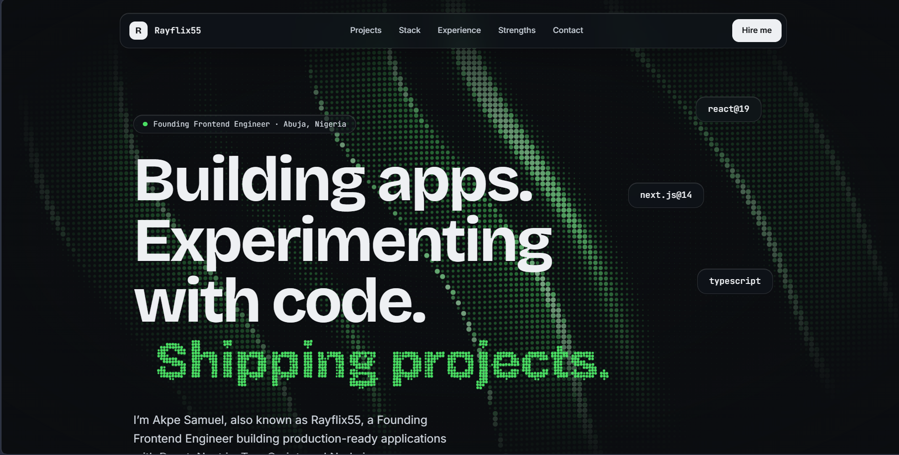

# rayflixthetechbro portfolio

Portfolio of Akpe Samuel (rayflixthetechbro), rebuilt from a single static HTML file into a React app.

**Stack:** React 19 · Vite · Tailwind CSS v4 · [PatternWaves](https://reactbits.dev) (ogl / WebGL2) · self-hosted variable fonts via Fontsource

## Scripts

| Command           | What it does                                                              |
| ----------------- | ------------------------------------------------------------------------- |
| `npm run dev`     | Dev server with HMR                                                       |
| `npm run build`   | Client build + SSR build + **prerender** into `dist/` (static, deployable) |
| `npm run preview` | Serve `dist/` locally                                                     |
| `npm run lint`    | ESLint                                                                    |

## Pages

| Route       | Page                                                              |
| ----------- | ----------------------------------------------------------------- |
| `/`         | Home: hero, about, featured work, stack, experience, services, contact |
| `/projects` | All 15 projects with real screenshots and a year filter           |

Both routes are prerendered at build time (`dist/index.html` and `dist/projects/index.html`) with their own
title, description, canonical URL and structured data, then hydrated by React Router on the client.
`vercel.json` enables clean URLs, so `/projects` serves the prerendered page.

## Editing content

All copy, links, projects, stack and experience live in [`src/data/site.js`](src/data/site.js).
Add a project by appending to `projects` and dropping `N.webp`, `N-640.webp` and `N-1024.webp` into `public/projects/`.

## Changing the background

[`src/components/Background.jsx`](src/components/Background.jsx) renders `<PatternWaves />`. Try `preset="ocean" | "pond" | "lines" | "terminal" | "mesh"`,
or tweak `color`, `opacity`, `fadeSize`, `cursorStrength`. See the prop table at reactbits.dev.

## SEO setup

- Set your real domain in `.env` (`VITE_SITE_URL`). It drives the canonical URL, Open Graph/Twitter tags, JSON-LD, `sitemap.xml` and `robots.txt`.
- Pages are prerendered at build time, so crawlers and link-preview bots see full HTML without running JavaScript.
- `public/og-image.png` is the social share card (1200×630); replace it with your own design if you like.

## Performance notes

- The WebGL background is a separate lazy chunk that starts after the page's `load` event and an idle callback.
- Compiling WebGL shaders blocks the main thread (ogl waits on the driver). The vendored `PatternWaves` shader was
  slimmed to keep that stall short: it compiles only the selected `wave` and uses 3 height samples instead of 5.
  Because of this, the `wave` prop is read once at mount (change it by remounting, e.g. with a `key`).

## Accessibility notes

- The WebGL background is a separate lazy chunk that loads when the browser is idle; text and layout never wait on it. If WebGL2 is unavailable the page falls back to a plain dark background.
- `prefers-reduced-motion` freezes the background animation and disables scroll animations.
- Skip link, landmarks (`header`/`main`/`aside`/`footer`), one `h1`, labelled sections, keyboard-closable mobile menu, visible focus rings.

## Deploying

`dist/` is plain static files, so it works on Vercel, Netlify, Cloudflare Pages or GitHub Pages
(build command `npm run build`, output directory `dist`).

## Automatic GitHub projects and starred repos

Your repos and the repos you have starred are pulled from GitHub automatically and shown on `/projects`,
with a preview image when they have one.

- **Your projects** are ordered as private repos, the manually selected Yagazie Weng and Tech BDI projects, then public repos.
  Public repos are shown newest recently pushed first if they are not forks or archived and have a live site (the repo's
  **Website** field) or a screenshot in their README. The first four projects in that combined order are featured on the home page.
- **Private repos** are synced first when a `PRIVATE_REPOS_TOKEN` (or local `GITHUB_TOKEN`) can read their metadata. Their names,
  descriptions, topics and creation years are published in the portfolio, but their GitHub source links, README contents and
  configured Website fields are not. Set a public demo explicitly with that repo's `liveLink` override if desired. The token is
  used only during the build/sync and is never included in the site. Without it, private repos cannot be discovered.
- **Starred repos** appear in their own "Starred on GitHub" section (they are other people's work, so they are kept apart
  from yours). Your own starred repos are not repeated there, and the section is hidden if there are none.
- **Preview image**, first one that works: the first screenshot in the README, then the live site's `og:image`. For
  your own repos it can also fall back to a rendered screenshot of the live site, then GitHub's repo card. Starred repos
  only ever use a *real* preview, so a repo without one is shown without a picture.
- **Always up to date:** `npm run build` syncs first (and keeps the cached data if GitHub is unreachable, so a deploy
  never fails because of it), and `.github/workflows/sync-github.yml` re-syncs every 6 hours, commits any change and
  your host redeploys. Add a repository Actions secret named `PRIVATE_REPOS_TOKEN` with read-only metadata access to
  the private repos you want included. Locally, set `GITHUB_TOKEN` to the same token.

| Command              | What it does                                          |
| -------------------- | ----------------------------------------------------- |
| `npm run sync`       | Run the sync now (fails loudly if something is wrong) |
| `npm run sync:force` | Same, but re-download every preview image             |
| `npm test`           | Tests for the sync (run against a mock GitHub)        |

Everything is configured in `github.config.json`: exclude repos, include forks, cap the public-project count, change the image order,
turn starred repos off (`"starred": { "enabled": false }`), or override a repo's `title`, `category`, `liveLink`, `image` and `tech`.
To get the best result for a new repo: set its Website field, add topics (they become the tech tags), write a one-line
description and put a screenshot at the top of the README.
# Latest-Portfolio
